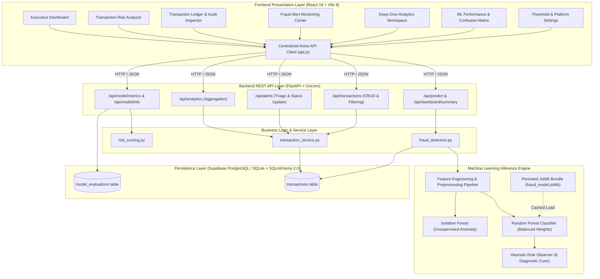
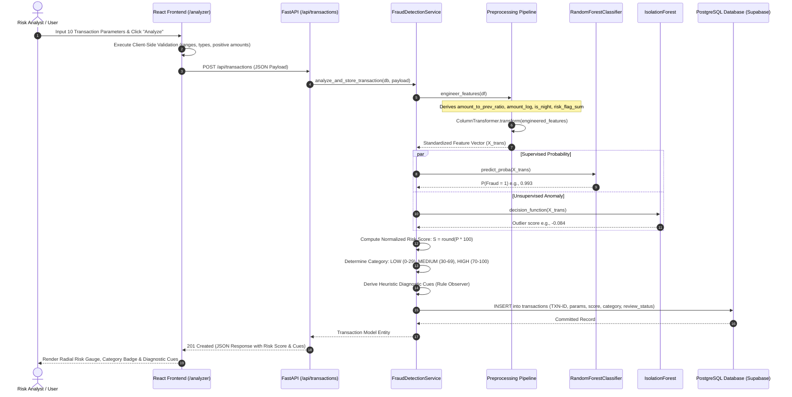

# Architecture Documentation
## AI-Powered Fraud Detection System

This document provides a comprehensive technical overview of the architecture, data flow, component interactions, and engineering patterns implemented in the **AI-Powered Fraud Detection System**.

---

## 1. System Overview & Architectural Paradigm

The system adopts a decoupled, multi-tier client-server architecture combining an event-driven analytical frontend with an asynchronous REST API backend and a machine-learning inference pipeline.

---

## 2. End-to-End Transaction Analysis Lifecycle

The sequence below illustrates the life of a transaction from submission on the user interface through real-time ML inference, heuristic evaluation, and persistence to the database.

---

## 3. Database Schema Design

The persistence tier is built on PostgreSQL (hosted on Supabase) and SQLite 3 for local development, managed through SQLAlchemy 2.0 ORM with declarative mapping, strict data type constraints, connection pooling with pre-ping validation, and B-tree indexing for sub-millisecond query throughput.

### 3.1 `transactions` Table
Stores all processed financial transactions along with their operational telemetry and machine learning inferences.

| Column | Type | Constraints | Description |
|---|---|---|---|
| `id` | Integer | Primary Key, Autoincrement | Internal synthetic record identifier |
| `transaction_id` | String(20) | Unique, Not Null, Index | Public formatted identifier (e.g. `TXN-8B4F92AC1E04`) |
| `transaction_amount` | Float | Not Null | Settled transaction currency value |
| `transaction_type` | String(20) | Not Null | Channel: `Payment`, `Transfer`, `Withdrawal`, `Deposit` |
| `merchant_category` | String(30) | Not Null | Sector: `Retail`, `Grocery`, `Travel`, `Electronics`, etc. |
| `transaction_hour` | Integer | Not Null | Clock hour of transaction ($0 - 23$) |
| `recent_transaction_count`| Integer | Not Null | Card velocity (number of transactions in past 24 hours) |
| `account_age_days` | Integer | Not Null | Age of originating customer account in calendar days |
| `location_distance` | Float | Not Null | Kilometers from cardholder's usual home location baseline |
| `new_device` | Boolean | Not Null, Default=False | Whether terminal device is previously unrecognized |
| `international_transaction`| Boolean | Not Null, Default=False| Whether clearing crossed international boundaries |
| `previous_transaction_amount`| Float | Not Null, Default=0.0 | User's 30-day historical mean transaction amount |
| `fraud_probability` | Float | Nullable | Raw ML statistical probability $P(\text{fraud} = 1) \in [0.0, 1.0]$ |
| `risk_score` | Integer | Nullable | Normalized integer risk rating $\in [0, 100]$ |
| `risk_category` | String(10) | Nullable, Index | Triage tier: `LOW`, `MEDIUM`, `HIGH` |
| `prediction` | Integer | Nullable | Binary model classification: $0$ (Legit) or $1$ (Fraud) |
| `review_status` | String(20) | Not Null, Index | Triage state: `Pending`, `Under Review`, `Confirmed Fraud`, `False Positive`, `Reviewed` |
| `created_at` | DateTime | Not Null, Index | UTC timestamp of transaction creation |

### 3.2 `model_evaluations` Table
Tracks versioned empirical performance metrics evaluated across model retraining cycles.

| Column | Type | Description |
|---|---|---|
| `id` | Integer (PK) | Unique evaluation record identifier |
| `model_version` | String(20) | Semantic version of trained model artifact (e.g. `1.0.0`) |
| `model_name` | String(50) | Algorithm family (e.g. `RandomForestClassifier`) |
| `dataset_name` | String(100) | Training dataset filename and origin |
| `num_samples` | Integer | Total sample population evaluated |
| `accuracy` | Float | Overall proportion of correct classifications |
| `precision` | Float | Positive predictive value: $\frac{\text{TP}}{\text{TP} + \text{FP}}$ |
| `recall` | Float | True positive rate / sensitivity: $\frac{\text{TP}}{\text{TP} + \text{FN}}$ |
| `f1_score` | Float | Harmonic mean: $2 \times \frac{\text{Precision} \times \text{Recall}}{\text{Precision} + \text{Recall}}$ |
| `roc_auc` | Float | Area under Receiver Operating Characteristic curve |
| `confusion_matrix`| String(100) | Comma-delimited values: `"TN,FP,FN,TP"` |
| `feature_importances`| String(1000)| Semicolon-delimited top feature contributions: `"feature:value;..."` |
| `evaluation_timestamp`| DateTime | UTC timestamp of model validation run |

---

## 4. Frontend Architecture & Design Philosophy

The client application is built with React 19 and Vite 8, utilizing Tailwind CSS v4 for utility-first styling.

### 4.1 Design System
- **Backgrounds**: Deep near-black slate (`#090D14` app background, `#0E1520` secondary surfaces, `#121B29` card containers, `#172335` elevated surfaces).
- **Accents**: Electric Blue (`#3B82F6`) and Cyan (`#22D3EE`) for primary interactive controls and focus states.
- **Risk Indicators**: Restrained semantic signals:
  - Low Risk: Emerald (`#22C55E`)
  - Medium Risk: Amber (`#F59E0B`)
  - High Risk: Rose (`#EF4444`)
- **Typography**: Clean sans-serif hierarchy with monospaced tabular numerals (`font-mono`) for currency values, transaction IDs, risk ratings, and timestamp strings.

### 4.2 State Management & Performance
- **Client-Side Routing**: Handled seamlessly by `react-router-dom` v7 with nested layout structures.
- **Data Visualizations**: Responsive vector rendering via Recharts (SVG) with debounced resize handlers and custom dark-theme tooltips.
- **API Client**: Centralized Axios singleton with baseURL dynamic discovery, 10-second timeout guards, and structured JSON parsing.

